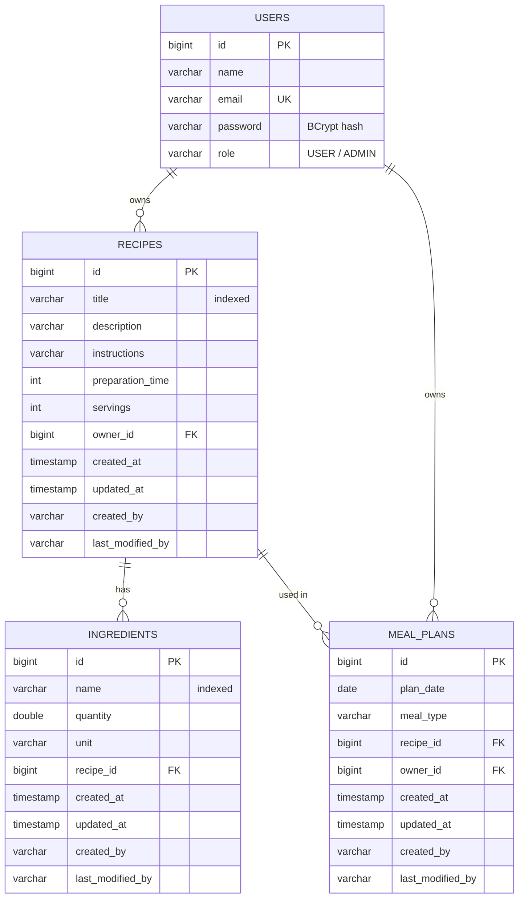

# Recipe Management API

A REST API (backend only) for managing cooking recipes, their ingredients and simple meal plans.
Users can register, log in with JWT, create and share recipes, search and page through recipes,
and plan their meals. There is no frontend. You use the API through **Swagger UI**.

| | |
|---|---|
| **Student** | Doğa Şimşek |
| **Student ID** | 34489 |
| **Course** | Desktop Application Programming II – Backend Development |
| **Topic** | Recipe Management API |

---

## 1. Technology stack

| Technology | Why it is used |
|---|---|
| Java 17 | Programming language |
| Spring Boot 3.3.5 | Application framework |
| Maven (with Maven Wrapper `./mvnw`) | Build tool. You do not need to install Maven |
| Spring Web | REST controllers |
| Spring Data JPA / Hibernate | Database access |
| H2 Database | Database (file for development, in-memory for tests) |
| Spring Security + JWT (jjwt 0.12.6) | Login and access control |
| BCrypt | Password hashing |
| Bean Validation | Input validation (`@NotBlank`, `@Size`, ...) |
| springdoc-openapi 2.6.0 | Swagger UI documentation |
| JUnit 5, Mockito, Spring Boot Test, MockMvc | Tests |
| JaCoCo 0.8.12 | Test coverage report |

## 2. Main features

- Register, log in, refresh token, "who am I" endpoint
- Passwords stored as BCrypt hashes
- JWT access token (60 minutes) and refresh token (7 days)
- Two roles: `USER` and `ADMIN`
- Recipe CRUD (with ingredients in the same request if you want)
- Ingredient CRUD (inside a recipe)
- Meal plan CRUD (private for each user)
- Search recipes by keyword
- Pagination and sorting (also by multiple fields)
- Custom validators and business rules
- Audit trail (who/when created and last changed a record)
- One JSON error format for all errors
- Swagger UI with JWT "Authorize" button

### Access rules

| Data | Who can see it | Who can change / delete it |
|---|---|---|
| Recipes and ingredients | Every logged-in user | Only the owner of the recipe or an ADMIN |
| Meal plans | Only the owner | Only the owner |
| `/api/admin/**` | Only ADMIN | Only ADMIN |

## 3. Three additional features (from the professor's list)

1. **Pagination & Sorting** – `GET /api/recipes`, `/api/recipes/search`, `/api/recipes/my` accept
   `page`, `size` (max 50) and one or more `sort` parameters. The response contains
   `totalElements`, `totalPages`, `first`, `last`. Only safe fields can be used for sorting
   (`id, title, preparationTime, servings, createdAt, updatedAt`).
2. **Advanced Validation**
   - `@ValidUnit` – custom annotation: unit must be one of `g, kg, ml, l, tsp, tbsp, cup, piece, pinch, slice, clove`.
   - `@ValidIngredientQuantity` – custom cross-field / conditional check: for `piece`, `slice`, `clove` the quantity must be a whole number (no "2.5 eggs").
   - Business rules in services: no duplicate ingredient names in a recipe, only one meal plan per date + meal type, meal plan date cannot be in the past, an admin cannot change their own role.
3. **Audit Trail** – `Recipe`, `Ingredient` and `MealPlan` extend `AuditableEntity`.
   Spring Data JPA fills `createdAt`, `updatedAt`, `createdBy`, `lastModifiedBy` automatically.
   Every response contains an `audit` object.

## 4. Project structure

```
recipe-management-api
├── pom.xml                      Maven configuration (dependencies, JaCoCo)
├── mvnw, mvnw.cmd, .mvn/        Maven Wrapper (no Maven installation needed)
├── README.md                    This file
├── DEFENSE_GUIDE.md             Step-by-step demo + questions for the defense
├── REQUIREMENTS_CHECKLIST.md    Professor's requirements vs. this project
└── src
    ├── main
    │   ├── java/com/dogasimsek/recipeapi
    │   │   ├── RecipeManagementApplication.java   Starts the app
    │   │   ├── config/        SecurityConfig, OpenApiConfig, JpaAuditingConfig, DataSeeder
    │   │   ├── controller/    AuthController, RecipeController, IngredientController,
    │   │   │                  MealPlanController, AdminController
    │   │   ├── dto/           Request and response records (no entity is returned directly)
    │   │   ├── entity/        User, Recipe, Ingredient, MealPlan, AuditableEntity, Role, MealType
    │   │   ├── exception/     GlobalExceptionHandler + custom exceptions
    │   │   ├── repository/    Spring Data JPA repositories
    │   │   ├── security/      JwtService, JwtAuthenticationFilter, CustomUserDetailsService,
    │   │   │                  SecurityErrorHandler
    │   │   ├── service/       Business logic (AuthService, RecipeService, ...)
    │   │   └── validation/    Custom validators (@ValidUnit, @ValidIngredientQuantity)
    │   └── resources
    │       ├── application.properties       Common settings
    │       └── application-dev.properties   Development profile (file H2, sample data)
    └── test
        ├── java/com/dogasimsek/recipeapi
        │   ├── service/       Unit tests with Mockito
        │   ├── controller/    Integration tests with MockMvc (full application)
        │   ├── repository/    Repository tests with @DataJpaTest
        │   ├── config/        DataSeeder test (sample data created once)
        │   ├── security/      JwtService tests
        │   └── validation/    Validation tests
        └── resources/application-test.properties   Test profile (in-memory H2)
```

Architecture: **Controller → Service → Repository → Database**.

## 5. Database design



- `Recipe → Ingredient`: One-to-Many with `cascade = ALL` and `orphanRemoval = true`
  (deleting a recipe deletes its ingredients).
- Unique constraints: `users.email`, `meal_plans (owner_id, plan_date, meal_type)`.
- Indexes: `recipes.title`, `recipes.owner_id`, `ingredients.name`, `ingredients.recipe_id`,
  `meal_plans (owner_id, plan_date)`.
- Hibernate creates the tables automatically (`ddl-auto=update`).

## 6. Installation

You need **Java 17 or newer**. Check it in the Terminal:

```bash
java -version
```

If Java is missing on a Mac (Apple Silicon M1 works):

```bash
brew install openjdk@17
```

You do **not** need to install Maven. The project contains the Maven Wrapper (`./mvnw`),
which downloads Maven the first time (internet needed once).

## 7. How to start the application

```bash
cd ~/Desktop/recipe-management-api
./mvnw spring-boot:run
```

Wait until you see `Started RecipeManagementApplication`. Stop it with `Ctrl + C`.

- **Swagger UI:** http://localhost:8080/swagger-ui.html
- OpenAPI JSON: http://localhost:8080/v3/api-docs
- H2 console (dev only): http://localhost:8080/h2-console
  (JDBC URL `jdbc:h2:file:./data/recipedb`, user `sa`, empty password)

Data is saved in the folder `data/`. To start again with an empty database:
stop the app and run `rm -rf data`.

### Profiles and environment variables

| Profile | When | Database |
|---|---|---|
| `dev` (default) | `./mvnw spring-boot:run` | H2 file `./data/recipedb`, sample data is created |
| `test` | automatically in tests | H2 in-memory, empty for every run |

| Environment variable | Meaning | Default |
|---|---|---|
| `JWT_SECRET` | Key used to sign JWTs (min. 32 characters) | not set → a random key is created at every start (log in again after a restart) |
| `SEED_ADMIN_PASSWORD` | Password of the local admin account | `Admin12345` |
| `SEED_USER_PASSWORD` | Password of the local user account | `User12345` |
| `DB_USERNAME` / `DB_PASSWORD` | Database login | `sa` / empty |
| `CORS_ALLOWED_ORIGINS` | Frontend URLs allowed by CORS | `http://localhost:3000,http://localhost:5173` |

Example with your own secret:

```bash
export JWT_SECRET="my-own-very-long-secret-key-with-at-least-32-chars"
./mvnw spring-boot:run
```

## 8. Test accounts (local development only)

The `DataSeeder` creates these accounts and the sample data below the first time the app starts
in the `dev` profile. It only adds data when the recipes table is empty, so restarting the app
never creates duplicates. This data does not exist in tests or in any other profile.

| Role | Email | Password |
|---|---|---|
| ADMIN | `admin@recipes.local` | `Admin12345` |
| USER | `user@recipes.local` | `User12345` |

| ID | Recipe | Time | Servings | Ingredients | Owner |
|---|---|---|---|---|---|
| 1 | Pasta | 20 min | 2 | Pasta, Tomato sauce, Cheese | USER |
| 2 | Pizza | 35 min | 4 | Pizza dough, Tomato sauce, Mozzarella | USER |
| 3 | Salad | 10 min | 2 | Lettuce, Tomato, Olive oil | USER |
| 4 | Omelette | 10 min | 1 | Egg, Butter, Salt | ADMIN |
| 5 | Soup | 40 min | 4 | Potato, Carrot, Water | ADMIN |

Sample meal plans (owned by the USER account): tomorrow BREAKFAST → Omelette,
tomorrow LUNCH → Salad, the day after tomorrow DINNER → Pasta
(dates are counted from the day the database is created).
New accounts created with `/api/auth/register` always get the `USER` role.

## 9. Authentication (how to use the JWT)

1. `POST /api/auth/login` with email and password.
2. Copy the `accessToken` from the response.
3. In Swagger click **Authorize** (lock icon), paste the token (without the word `Bearer`), click **Authorize**.
4. Now every request sends the header `Authorization: Bearer <token>`.

When the access token expires (60 minutes), call `POST /api/auth/refresh` with the `refreshToken`.

## 10. API endpoints

| Method | URL | Who | Description |
|---|---|---|---|
| POST | `/api/auth/register` | public | Register (role USER) |
| POST | `/api/auth/login` | public | Log in, get tokens |
| POST | `/api/auth/refresh` | public | New access token from refresh token |
| GET | `/api/auth/me` | logged in | Current user |
| GET | `/api/recipes?page=0&size=10&sort=title,asc` | logged in | All recipes (paged) |
| GET | `/api/recipes/search?keyword=soup` | logged in | Search title/description (paged) |
| GET | `/api/recipes/my` | logged in | My recipes (paged) |
| GET | `/api/recipes/{id}` | logged in | One recipe |
| POST | `/api/recipes` | logged in | Create recipe |
| PUT | `/api/recipes/{id}` | owner / ADMIN | Update recipe |
| DELETE | `/api/recipes/{id}` | owner / ADMIN | Delete recipe (+ ingredients + meal plans using it) |
| GET | `/api/recipes/{recipeId}/ingredients` | logged in | List ingredients |
| GET | `/api/recipes/{recipeId}/ingredients/{id}` | logged in | One ingredient |
| POST | `/api/recipes/{recipeId}/ingredients` | owner / ADMIN | Add ingredient |
| PUT | `/api/recipes/{recipeId}/ingredients/{id}` | owner / ADMIN | Update ingredient |
| DELETE | `/api/recipes/{recipeId}/ingredients/{id}` | owner / ADMIN | Delete ingredient |
| GET | `/api/meal-plans` | logged in | My meal plans |
| GET | `/api/meal-plans/{id}` | owner | One meal plan |
| POST | `/api/meal-plans` | logged in | Create meal plan |
| PUT | `/api/meal-plans/{id}` | owner | Update meal plan |
| DELETE | `/api/meal-plans/{id}` | owner | Delete meal plan |
| GET | `/api/admin/users` | ADMIN | List users |
| PUT | `/api/admin/users/{id}/role` | ADMIN | Change role of a user |
| GET | `/api/admin/stats` | ADMIN | Counts of users, recipes, ingredients, meal plans |

## 11. Sample requests and responses

**Register** – `POST /api/auth/register`

```json
{ "name": "Doga Simsek", "email": "doga@example.com", "password": "Password123" }
```

Response `201 Created`:

```json
{ "id": 3, "name": "Doga Simsek", "email": "doga@example.com", "role": "USER" }
```

**Login** – `POST /api/auth/login`

```json
{ "email": "user@recipes.local", "password": "User12345" }
```

Response `200 OK`:

```json
{
  "accessToken": "eyJhbGciOi...",
  "refreshToken": "eyJhbGciOi...",
  "tokenType": "Bearer",
  "expiresIn": 3600,
  "user": { "id": 2, "name": "Demo User", "email": "user@recipes.local", "role": "USER" }
}
```

**Create recipe** – `POST /api/recipes`

```json
{
  "title": "Spaghetti Bolognese",
  "description": "Pasta with meat sauce",
  "instructions": "1. Cook the sauce. 2. Boil the pasta. 3. Mix.",
  "preparationTime": 45,
  "servings": 4,
  "ingredients": [
    { "name": "Spaghetti", "quantity": 400, "unit": "g" },
    { "name": "Minced beef", "quantity": 300, "unit": "g" },
    { "name": "Onion", "quantity": 1, "unit": "piece" }
  ]
}
```

Response `201 Created` (shortened):

```json
{
  "id": 6,
  "title": "Spaghetti Bolognese",
  "preparationTime": 45,
  "servings": 4,
  "ownerId": 2,
  "ownerName": "Demo User",
  "ingredients": [
    { "id": 16, "name": "Spaghetti", "quantity": 400.0, "unit": "g", "recipeId": 6,
      "audit": { "createdAt": "2026-11-25T10:15:30", "createdBy": "user@recipes.local",
                 "updatedAt": "2026-11-25T10:15:30", "lastModifiedBy": "user@recipes.local" } }
  ],
  "audit": { "createdAt": "2026-11-25T10:15:30", "createdBy": "user@recipes.local",
             "updatedAt": "2026-11-25T10:15:30", "lastModifiedBy": "user@recipes.local" }
}
```

**Paged list** – `GET /api/recipes?page=0&size=2&sort=preparationTime,asc&sort=title,asc`

```json
{
  "content": [ "... Omelette, Salad ..." ],
  "page": 0, "size": 2, "totalElements": 5, "totalPages": 3,
  "first": true, "last": false, "sort": "preparationTime: ASC,title: ASC"
}
```

**Validation error** – `400 Bad Request`

```json
{
  "timestamp": "2026-11-25T10:20:00",
  "status": 400,
  "error": "Bad Request",
  "message": "Validation failed",
  "path": "/api/recipes",
  "validationErrors": {
    "preparationTime": "Preparation time must be at least 1 minute",
    "ingredients[0].quantity": "Quantity must be a whole number for countable units (piece, slice, clove)"
  }
}
```

**Error status codes used:** 400 (invalid input / business rule), 401 (no or bad token, wrong login),
403 (not allowed), 404 (not found), 405 (wrong HTTP method), 409 (duplicate e-mail / meal plan slot),
500 (unexpected error, no internal details shown).

## 12. Running the tests

```bash
./mvnw test
```

Tests use the `test` profile (in-memory H2), so they do not touch your demo data.

## 13. Test coverage (JaCoCo)

```bash
./mvnw verify
open target/site/jacoco/index.html
```

`./mvnw verify` runs all tests, creates the report and **fails the build** if line coverage is below
60% overall or below 70% in the `service` package.

Measured result (last run, 115 tests, all passing):

| Package | Line coverage |
|---|---|
| service | 100.0% |
| **Overall** | **96.3%** |

## 14. Troubleshooting

| Problem | Solution |
|---|---|
| `Port 8080 was already in use` | Another app uses port 8080. Find it with `lsof -i :8080` and stop it with `kill <PID>`, or stop the other Terminal with `Ctrl + C`. |
| `permission denied: ./mvnw` | Run `chmod +x mvnw` once. |
| `java: command not found` or wrong version | Install Java 17: `brew install openjdk@17` and follow the printed instructions. |
| 401 in Swagger | Log in again, click **Authorize**, paste only the token (no `Bearer`, no quotes). Old tokens stop working after a restart unless `JWT_SECRET` is set. |
| 403 in Swagger | You are logged in with a role that is not allowed, or the record belongs to another user. |
| `Database may be already in use` | The app is already running in another Terminal. Stop it first. |
| Want a fresh database / the sample data | Stop the app, run `rm -rf data`, start again. Sample data is only created when the database has no recipes. |
| Meal plan date error | The date must be today or later, format `yyyy-MM-dd`. |

## 15. Upload to GitHub

The project is a Git repository with one commit. To publish it:

1. Create a new **empty** repository on https://github.com/new (no README, no .gitignore).
2. Run (replace `YOUR-USERNAME`):

```bash
git remote add origin https://github.com/YOUR-USERNAME/recipe-management-api.git
git branch -M main
git push -u origin main
```

The `.gitignore` keeps `target/`, `data/` (database files), `.env` files and IDE files out of Git.
No JWT secret is stored in the repository. The only passwords in it are the documented
local test accounts (`Admin12345`, `User12345`), which exist only in the `dev` profile on your own computer.
